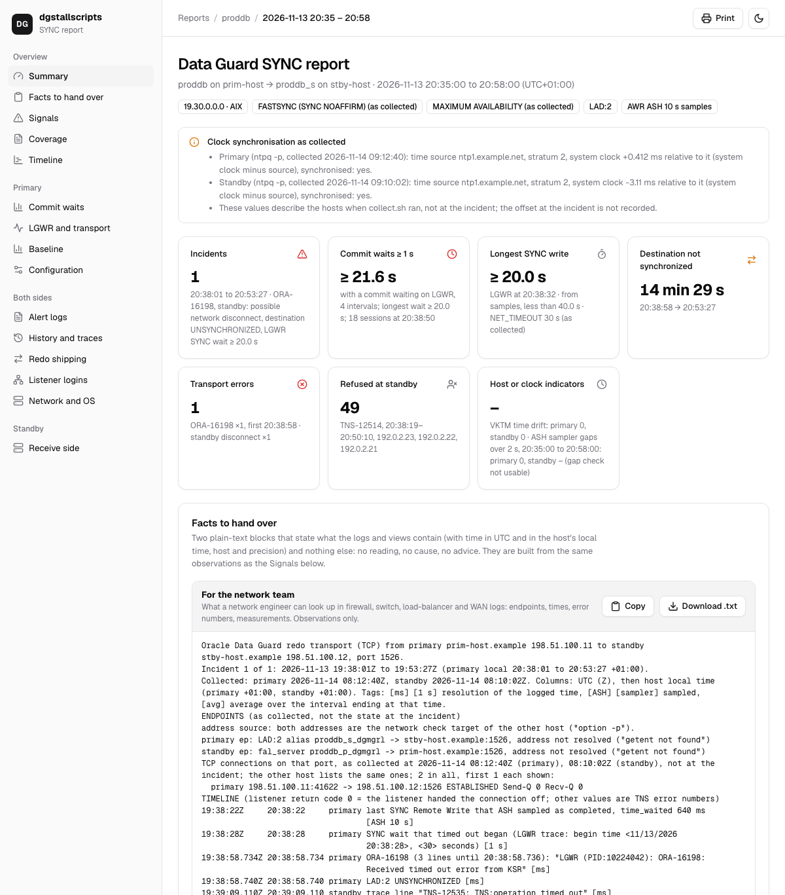

# dgstallscripts

Read-only scripts that work out why commits stalled on an Oracle Data Guard primary with a SYNC or
FASTSYNC standby: LGWR waiting on `SYNC Remote Write`, sessions piling up on `log file sync`,
ORA-16198, and the destination going `UNSYNCHRONIZED`. They collect the evidence from both hosts and
turn it into one HTML report.

<picture>
  <source media="(prefers-color-scheme: dark)" srcset="docs/report-dark.png">
  
</picture>

**[Open the sample report](https://raw.githack.com/davidbudac/dgstallscripts/main/examples/sample-report.html)**
(or download [`examples/sample-report.html`](examples/sample-report.html) and open it). It is built
from the synthetic bundles in [`examples/`](examples): fictional names and documentation IP addresses,
shaped like a real incident.

## Quick start

Copy this directory to both database hosts. Run the collector as the `oracle` user with the
environment of the database set (`ORACLE_SID`, `ORACLE_HOME`, `PATH`). Pick a window that starts a few
minutes before the first symptom and ends after the destination is `SYNCHRONIZED` again. If you do not know the
window of a past incident, `sh/collect.sh list` finds it in the alert log (see [Finding the window](#finding-the-window)).

```sh
# 1. On the standby
sh/collect.sh standby "2026-11-13 20:35" "2026-11-13 20:58"

# 2. On the primary, after copying the standby bundle over (the run above prints this exact command)
sh/collect.sh -c dgr_standby_<host>_<ts>.jsonl primary "2026-11-13 20:35" "2026-11-13 20:58"

# 3. Anywhere with both bundles in one directory: a database host or your laptop (the primary run prints this command)
sh/make_report.sh -o report.html
```

Open `report.html` in any browser. It is a single file with no external resources, so it works offline
and can be attached to a ticket.

- Each `collect.sh` run writes one bundle, `dgr_<side>_<host>_<timestamp>.jsonl`, and prints what it
  found and what to run next. A full run takes about half a minute.
- `-c` is optional. Without it, the clients refused at the standby are listed but not looked up on the primary.
  `-p` is optional too: without it the collector derives the peer address (see [Network evidence](#network-evidence-and-clock-state)).
- `make_report.sh` without bundle arguments takes every `./dgr_*.jsonl` in the current directory and prints which
  files it took (or says that there are none). Name the files to choose.
- One bundle is enough for a report. The sections that need the other side say what is missing.

To collect every incident of a past period (a whole month, say), let `list` print all the commands, then paste each block on the host it names
([Finding the window](#finding-the-window); N incidents mean N full collections on each host):

```sh
# on the primary (on a standby add -a <text alert log>)
sh/collect.sh list -s "2026-11-01" "2026-11-30" > cmds.sh
# cmds.sh holds the standby commands, then the primary commands, then the report commands
```

## What the report shows

The page has two panes, chosen with the **Report** and **Hand-over** tabs at the top, the sidebar or the address (`#handover` opens the hand-over pane; a link to something in the other pane switches pane first). The Report pane is the default and lists the charts first (the timeline, the sequence, the waits, the baseline, the day-and-hour view, the listener, standby receive and sampler charts), then the findings (Signals, Explanations, Before the next occurrence, Coverage, Episodes side by side), the logs and the configuration and hosts. The hand-over texts are in their own pane, last in the table. Captions and notes are kept to the source, the unit and the counts of the data: explanations of method are in this README, not on the page. Printing prints the pane that is shown; the Reading disclosures open for the printout.

| Section | What it answers | Source |
|---|---|---|
| Summary | Incidents found, commit waits of 1 s or more (from the individual waits, with their bound), the longest SYNC write, time not synchronized, transport errors, refused logins, host or clock indicators (the standby's sampler gaps included) | ASH, alert log, listener log |
| Incident timeline | Alert messages, commit waits, LGWR, NSS/TT and archiver waits, **the standby's RFS and apply waits** (two lanes), destination state, standby logins and redo rate on one clock, zoomable (see [Zooming the charts](#zooming-the-charts)) | Everything |
| **Sequence of the incident** | Per incident (a selector picks it; printing shows all), an SVG with two lanes on one time axis, primary above standby, zoomed to the incident: a "stall" panel (from before the last completed SYNC write to shortly after the first errors) and a "recovery" panel (the reconnect and the return to `SYNCHRONIZED`), one panel when everything fits in about 90 s. Built only from the Observed facts of the incident (the ones the hand-over timeline lists); each mark sits on the lane of the host that logged it and has the precision of its time: a point for a millisecond timestamp, a 1 s wide mark for a 1 s timestamp, the sampling interval for an ASH sample, an interval for the SYNC wait. The shaded band around a standby mark is the cross-host margin (2 s): the order of marks of the two lanes inside it is not established. Marks are numbered, with a legend below; hover shows time, source and precision, a click jumps to the Observed row | Observed facts |
| Commit waits per minute | Average sessions on `log file sync` with LGWR as the blocker, other waits, CPU | ASH or AWR ASH |
| **Who waited** | Per incident (tabs; with no incident the whole window): three ranked lists of the services, modules and machines whose sessions were sampled on `log file sync`, as horizontal bars: samples, of those the samples behind LGWR, distinct sessions (sample counts with the ASH source and its sampling interval, never durations; the lists are for the whole window because the record cannot be split by incident; capped, not covered or "not checked" because its statement failed is stated); the most sessions waiting in one sample; and the per-minute transactions, redo and logons in up to 5 minutes before the first event against the lowest minute of the incident, with the minutes named (with fewer than 2 minutes before the first event inside the window it says so instead). Report only: it is not in the hand-over texts | `lfs_by`, `lfs_sum`, `wl`, `cov` |
| Longest waits, SYNC Remote Write | Merged LGWR/transport/archiver waits, each with its length as exact or as a range; histogram for the window (AWR), since startup, and the response histogram of the destination (as collected) | ASH, AWR, `v$event_histogram_micro`, `v$redo_dest_resp_histogram` |
| Baseline | The wait histograms of the window against the same clock interval on each of the previous days: how many of those days had usable data, the share of waits in buckets over 1 s per day | `dba_hist_event_histogram` |
| Other episodes by day and hour | Start of each episode of the history by day (rows, newest first) and hour of the day, with the recurring time of day outlined (with `act` records a strip under the marks holds the RMAN commands as bars, start to end, and the job runs that overlap the start of an episode) | Alert logs, `act` |
| Listener logins | Logins per minute on each side, refusals marked | Listener logs |
| Standby: RFS write latency | RFS write waits since the instance started, as a histogram (with its start time, and the statement that counters of an instance that started after the window hold nothing from it) | `v$event_histogram_micro` |
| Network sampler | The sampler of the window: one ping, the TCP retransmit counter and the largest Send-Q to the peer per sample | `net_sampler.sh` |
| Signals | One block per incident: **Observed** (what a log or view contains, each with time, host, source and precision) and, separately, **Reading** (what it may mean: conditional, with its assumption and what else fits; a closed disclosure, "Reading (n)", opened when the page is printed); what is ruled out and what was not checked. Newer Observed rows: the standby's own ASH samples inside the wait that timed out, the new connections of the peer at each listener, the network counters of the window around the incident, the NTP state as collected | All other sections |
| **Explanations and what the bundles hold** | One table per incident, after Signals: seven candidate explanations (redo lost on the network path, an idle timeout, a slow standby, a stopped standby host, a standby instance shut down or restarted, a stopped primary host or a clock jump, a slow local redo write) in rows, and four columns with the report's own words: **Observed**, **Ruled out**, **None found**, **Not checked**. A cell lists the titles of the entries of Signals that bear on that row, each linking to its row (facts of one kind and name are one entry with their count and time range, linking to the first row); the facts every row would produce alike (the timeout error, the destination leaving the synchronized state) are listed once above the table. It re-arranges what Signals already computed through a fixed map and adds no finding | Signals |
| **Before the next occurrence** | After Explanations: for each Not-checked entry that more collection could settle, what would have provided the evidence and the command (`sh/collect.sh ...` with the window of the bundle, collecting sooner, the other side's bundle, collecting a v1 bundle again, the sampler `sh/net_sampler.sh <peer IP> <port>`), each hint once with the entries it concerns. Where the missing thing is outside the tool (a firewall's idle timeout) it says so and gives no command. The same hint also stands under its entry in Signals | Not-checked entries |
| Coverage | What each source held (from the `cov` records, the newer sources included), so a "Not checked" entry can be understood, and whether it **reached the window**: the whole window, part of it, not at all, as collected, or not applicable (not read). A notice at the top names the sources that no longer reach the window and how long after the window each bundle was collected. A capped lookback source shows the time of its oldest kept record ("kept from") beside what its view holds, and one whose statement failed reads "not checked" with the note of its record | `cov` records, bundle headers |
| **Episodes side by side** | After Coverage: one row per incident of the window (marked) and per episode of the history, newest first: start (date, weekday, time of day), what was logged and on which side, first to last line, **the first line that ends the UNSYNCHRONIZED period after it** (or "no return line in the history", or "not covered"), **the redo rate of the AWR interval that contains the start** (average and largest 1 minute value, with the interval's begin and end), and **the activity at the start**: RMAN commands and job runs that were running or began within 10 minutes before it, a log switch within 60 s. Columns whose records are not in the bundles are left out. Under the table plain counts ("an RMAN command named X started within 10 minutes before 6 of the 7 episodes that `v$rman_status` covers") and one conditional Reading (a closed disclosure): coincidence in time does not show that an activity produced the episodes, and work scheduled outside the database is not in these views | `alhist`, `alsync`, `wl_hist`, `act`, `cov` |
| Other occurrences in the alert logs | Data Guard messages outside the window grouped into episodes, **before and after it** (the history is read back from the collection time; routine `RT_PMODE` lines are not counted); the recurrence statement, with its conditional Reading in a closed disclosure | Alert logs |
| Alert logs | Primary and standby merged, filterable; rows that match Data Guard or transport patterns are coloured; **`v$dataguard_status` rows of both sides sit among them with a tag of their own** (and have a tab) | `v$diag_alert_ext`, alert log file, `v$dataguard_status` |
| Background traces | Lines matching error patterns in LGWR, NSS, TT, ARC, TMON, RFS and MRP traces in the window | Trace files |
| Redo shipping | When each sequence reached the standby, and whether it came as a gap (FAL) | `v$archived_log` |
| Refused clients | The clients refused at the standby listener, looked up by `CONNECTION_ID` in the primary listener log (whether they reached the primary) | Listener logs |
| Configuration | Transport mode, `NET_TIMEOUT`, `REOPEN`, protection level, standby redo logs, lag, **endpoints (alias to host, port and address), the `sqlnet.ora` timeouts, the OS TCP settings**, all as collected | `v$archive_dest`, `v$database`, `v$standby_log`, `v$dataguard_stats`, `tnsnames.ora`, `sqlnet.ora`, `sysctl` / `no -a` |
| Standby: receive side | The standby's RFS counters since startup, its wait samples in the window (RFS apart from the other processes), the Data Guard processes and archive gaps as collected | `v$system_event`, `v$active_session_history`, `v$dataguard_process`, `v$archive_gap` |
| Network and OS | **In the window:** the sysstat history (`sar` per interface, errors, TCP retransmissions; each row an average over its interval). **At collection time, kept apart:** round trip, loss, retransmit counter and Send-Q to the peer, and the TCP connections to it | `sar`, `ping`, `netstat` |
| **Facts to hand over** (the **Hand-over** pane) | Two plain-text blocks, one per incident, built from the same observations as Signals: **For the network team** (endpoints, the incident timeline in UTC and local time, error blocks with their TNS/ns/nt/OS numbers, the peer's new connections at the listener, network counters of the window and at collection time, timeouts, clocks, recurrence, what was not available) and **For the ticket** (databases, when, how long the destination was not synchronized, commit waits and the longest SYNC write with their bounds, errors with their codes, what the data covered). Each has Copy and Download .txt buttons; the pane prints with every incident. See [Facts to hand over](#facts-to-hand-over) | everything in the report |

### Zooming the charts

The incident timeline, commit waits per minute, listener logins and the network sampler show the same time range, and zooming one zooms all four:

- **Drag** across a chart to zoom to that stretch (10 s at the narrowest).
- **Ctrl/⌘ + wheel** zooms in or out around the pointer. In Chrome, Edge and Firefox a trackpad pinch works too. A plain wheel still scrolls the page.
- **Shift + wheel**, or a sideways swipe, pans a zoomed range.
- **Double-click** a chart, or press **Whole window** above it, to show the whole window again.
- The timeline's **Incident N** tabs set the range to the incident with a minute either side, for all four charts.

A zoomed chart has a line above it with the range shown. The line prints too, so a printout says it is not the whole window. The per-minute bars and the y scales of commit waits and listener logins are fitted to the range shown. The sequence of the incident is already framed per incident, and the histograms and the day-and-hour grid are not on the window's clock, so none of these zoom.

Clock state: when `ntp` records exist, a notice at the top gives each host's synchronisation as collected (source, stratum, offset). It describes the hosts when `collect.sh` ran, not at the incident.
Every newer record type is optional: a bundle without it renders as before, with "not collected" where its section would be. One more notice: when the primary is a **RAC** database (see below).

### Facts to hand over

The **Hand-over** pane (the second tab, or the address `#handover`) holds two plain-text blocks for people who need the facts without the conclusions. They are built from the same list of observations the Signals use (`FACTS`, also embedded as JSON) and from the values derived from it, so they cannot disagree with the report.
With more than one incident in the window there is one block per incident (a selector picks it; printing the pane shows them all). Copy and Download .txt work on the block that is shown.

- **For the network team:** what a network engineer can look up in firewall, switch, load-balancer and WAN logs. Hosts, addresses and listener port and how they were found (the `ep` record); the TCP connections between the hosts at collection time; a timeline with each time in UTC (`Z`) and in the host's own local time, the host that logged it and its resolution (`[ms]`, `[1 s]`, `[ASH]`): the last completed SYNC write before the stall, the start of the wait that timed out (when the LGWR trace gives it consistently), the timeout or lost-connection error with its Oracle code, the network-layer error blocks of either host with their TNS, ns, nt and OS numbers and the client address in them (local BEQ blocks are left out), the new connections of the other host at each listener (source IP and port, time, return code) and the time the destination was synchronized again; VKTM lines, sampler gaps and shutdown lines (or that none were found, or why that was not checked); sysstat and sampler figures of the window, apart from the check at collection time; the timeouts and OS settings; each host's UTC offset and NTP state; other episodes in the alert-log history in UTC, before and after the window, with the lookback and whether the history was capped; and one line for every source that did not cover the incident. About 60 lines of at most 110 columns for one incident; long lists end in a count ("N more in the report").
- **For the ticket:** a shorter block of facts for a general audience: databases, hosts, versions, when, how long the destination was not synchronized, commit waits and the longest SYNC write with their bounds, transport errors with codes, and what the data did and did not cover. No title, summary, impact, cause or next steps: those are yours to write.

Both state observations only. Everything that comes from a log is in quotation marks; a test fails the build when either text contains interpretation (`points to`, `likely`, `cause`, `because`, `consistent with`, `may`, `should` ...), advice or a question outside quoted log text (`tests/wording.py`). Current-state values say "as collected" with their time, sampled durations are bounds exactly as the report states them, and a source that did not cover the incident is listed with the reason from its `cov` record. Copy uses the clipboard (a selection fallback where it is missing); Download .txt writes the block through a Blob, no network.

### Several episodes in one report

Bundles of several collection windows can go into one `make_report.sh` call (or one directory of `dgr_*.jsonl` files): each window is an episode. When a side has more than one bundle, the page forms one set per primary bundle, in the order of the window start (1 is the oldest). A standby bundle joins the primary bundle whose header has the same `from` and `to`, otherwise the primary bundle whose window overlaps its own most (compared in UTC, with each bundle's own UTC offset; a tie goes to the earlier set); a standby bundle that overlaps no primary bundle is a set of its own. Two primary bundles are never pooled, even when their windows overlap. One primary and one standby bundle are one set whatever their windows (a pair collected by hand may differ by a minute).

The page analyses one set at a time, exactly as a report built from that pair alone would: every section, claim and hand-over text is that pair's. The address chooses the set: `report.html?ep=2` shows the second, `report.html?ep=2#handover` its hand-over pane; a missing or invalid number shows the first. A card "Episode k of N in this report" at the top of both panes lists the sets (window, bundles with side, host and file name, and what their alert lines hold: the time of the first line with a Data Guard error code and the codes found) with a link to each, Previous and Next; with more than eight sets the table is in a disclosure under that heading. The page title and a printout say which episode is shown. `sh/collect.sh list -s` prints the commands that collect the bundles of every episode of a period and the `make_report.sh` call that holds them all, and `make_report.sh` says on stderr when its bundles hold more than one window.

## Requirements and safety

- Oracle 19c (tested on 19.27). The primary must be open; the standby can be mounted.
- A POSIX shell and awk. Tested on Linux; the scripts avoid GNU-only options so they run on AIX (see [what is unverified on AIX](#what-is-unverified-on-aix)).
- `sqlplus` connecting as SYSDBA (`/ as sysdba` by default).
- The ASH and AWR parts (including `lfs_by` and `wl_hist`) need the **Diagnostics Pack** license.
- **RAC is detected, not supported.** `meta` records `cluster_database` and the number of open instances; the tool reads the instance it runs on. The report says
  that blockers and LGWR on the other instances are not resolved and that figures may be incomplete.
- **Read-only.** The SQL is `SELECT` only, plus `ALTER SESSION` for date formats. The shell scripts only read logs and files and run display commands, listed here
  so you can judge them: `sqlplus`, `lsnrctl status`, `ping -c 10 <peer>`, `netstat -an`, `netstat -s`, `getent hosts <host>`, `sysctl -n <four net.ipv4.* names>` (Linux),
  `no -a` (AIX), `chronyc tracking`, `ntpq -p`, `timedatectl`, `lssrc -s xntpd` (AIX), `LC_ALL=C S_TIME_FORMAT=ISO sar -n ETCP|TCP|DEV|EDEV -f <daily file>` (Linux; `collect.sh list` runs `sar -f <daily file>` for the banner date only),
  `find`, `touch -t` on a temporary file, `uname`, `hostname`, `date`. Files are written to the current directory and `/tmp`. Nothing is installed, configured or left running:
  `collect.sh` never starts the sampler.
- The heaviest step is reading the alert log through `v$diag_alert_ext`: one pass for the "earlier occurrences" history and one for its coverage record, both limited to the last
  `-d` days (the lines that end an UNSYNCHRONIZED period, the `alsync` records, ride the same two passes). Use `-d 7` to shorten it on a large alert log. The commit-wait, sampler-gap and transport-sample records add six statements over ASH (the in-memory view or the AWR copy,
  whichever covers the window) and `lfs_by` two more; the baseline adds three over `dba_hist_event_histogram` and `dba_hist_snapshot` (`-b 0` leaves it out); `wl_hist` adds two over `dba_hist_sysmetric_summary`; the scheduled activity adds two small ones each over
  `v$rman_status`, `cdb_scheduler_job_run_details` and `v$log_history`.
- Bundles and reports contain host names, IP addresses and ports, connection IDs and log text. Handle them like the logs themselves.

## `collect.sh` options

```
sh/collect.sh [options] primary|standby "YYYY-MM-DD HH:MI" "YYYY-MM-DD HH:MI"
sh/collect.sh list [-s] [-d days] [-a alert log] [-u conn] [from [to]]
```

| Option | Default | Meaning |
|---|---|---|
| `-o file` | `./dgr_<side>_<host>_<now>.jsonl` | Bundle to write |
| `-u conn` | `/ as sysdba` | sqlplus connect string |
| `-t dir` | `Diag Trace` from `v$diag_info` | Trace directory |
| `-a file` | `<trace dir>/alert_$ORACLE_SID.log` | Text alert log (read on the standby; on the primary only when given) |
| `-l file` | from `lsnrctl status` | Listener text log |
| `-c file` | none | Standby bundle whose refused CONNECTION_IDs are looked up in this listener log |
| `-p ip` | derived | Peer redo IP for the 10 s network check; wins over the derivation |
| `-P port` | derived, else 1521 | Peer listener port (primary: from the destination descriptor; standby: its own listener port from `lsnrctl status`) |
| `-n file` | none | Log of `sh/net_sampler.sh`: add the samples inside the window (the rotated `<file>.1` is read too) |
| `-N` | off | Passive collection: skip the live network check (no `ping`, no `netstat` towards the peer). Logs, sysstat files and the database are still read |
| `-d days` | 30 | How far back "earlier occurrences" (SQL and text alert log alike) and `list` look (`list` with a `from` does not use it) |
| `-b days` | 7 | Baseline: the same clock interval on each of the previous days, primary only, from AWR (0 = none, at most 31) |
| `-s` | off | `list` only: print nothing but the commands (all for the standby host, then all for the primary host, then the reports) |
| `from [to]` | none | `list` only: a period instead of "`-d` days back from now": `YYYY-MM-DD`, `YYYY-MM-DD HH:MI` or `YYYY-MM-DD HH:MI:SS` each; a date alone is the start of that day for `from` and the end of that day for `to`; no `to` = now |

Environment: `SQLPLUS` (the sqlplus binary), `SA_DIR` (the sysstat directory; default `/var/log/sa`, then `/var/log/sysstat`), `TNS_ADMIN` / `ORACLE_HOME` (where `tnsnames.ora` and `sqlnet.ora` are read),
`DGR_NOW` (`YYYY-MM-DDTHH:MI:SS`, replaces the clock: for tests).

The window is in the hosts' local time and may cross midnight or span several days; both ends count to the second. Only the listener whose log `lsnrctl status` reports is scanned; pass `-l` for another one.
After a standby run `collect.sh` prints the exact command for the primary (window, `-c <this bundle>`) and a reminder to copy the bundle over; after a primary run it prints the `make_report.sh` command.

Limitations: nothing is dropped silently, but some sources are capped (trace lines 400, earlier occurrences 300, refused logins 500, server-to-server connections 500, CONNECTION_ID hits 2000,
individual commit waits 200, sampler gaps 50, standby ASH samples 5000, `v$dataguard_status` rows 500, sysstat rows 2000 per report, TCP connections 200, sampler samples 5000,
commit-wait groups 15 per list (service, module, machine), workload intervals 1500, lines that end an UNSYNCHRONIZED period 300, RMAN commands 500, scheduler job run records 2000 (a job that runs more than 24 times a day is one summary record), log switches 5000,
trace files modified in the last 45 days). Every cap, every source that was skipped or failed, and what each source held is written to the bundle as `cov`
records ([bundle format](docs/bundle-format.md)). At the end `collect.sh` prints one line per `cov` record, `src` or `src/kind` where the record has a kind (`act/job`, `sar/ETCP`, `ash/V`), with its status, its count and CAPPED where it was; an Oracle error is shown by its first `ORA-` or `SP2-` line, `ERROR at line N:` only when there is none.
If sqlplus cannot connect, `collect.sh` prints `database: FAILED: ...`, still scans the logs and exits with status 1.
A statement that fails leaves an `error` cov record and its Oracle error in the bundle; the report lists it as a failed query.

### What else is collected

All of it optional in a bundle, each with a `cov` record; [docs/bundle-format.md](docs/bundle-format.md) defines every field and says whether a record is read "as collected" (the host or view now) or from inside the window.

| Where | Record | What | Source |
|---|---|---|---|
| Standby | `rfs_ev`, `hist_su` | RFS receive/write latency since instance startup (`meta.startup`): waits, time, 1 us..s buckets | `v$system_event`, `v$event_histogram_micro` |
| Standby | `tx`, `ashgap` | Samples of PRnn, MRP0, ARCn, TTnn, TMON, LGWR, DBWn, CKPT and the RFS processes (`program` `oracle@<primary host> (TNS V1-V3)`, the client program on the primary; a database link looks the same) in the window; sampler-gap check. ASH is in memory: collected hours later it no longer reaches the window, and `cov ash` says what it holds | `v$active_session_history` |
| Both | `dgstatus` | Data Guard messages in the window; `cov` carries the oldest/newest row the in-memory view holds | `v$dataguard_status` |
| Standby | `dgproc`, `archgap` | Data Guard processes and gaps, as collected | `v$dataguard_process`, `v$archive_gap` |
| Primary | `dest_hist` | Response time per destination in whole-second buckets, as collected | `v$redo_dest_resp_histogram` |
| Primary | `base_day`, `base_hist` | `SYNC Remote Write` and `log file sync` histogram for the same clock interval on each of the previous `-b` days; restarts (counter resets) are left out | `dba_hist_event_histogram` |
| Both | `lsnr_srv` | Connections with `PROGRAM=oracle` (an Oracle server process as client: normally the other database host, but database links match too) at the listener in the window: time, client host, source IP and port, service, return code (what a firewall log can be matched against) | listener log |
| Both | `ep`, `conn`, `sqlnet`, `ostcp` | Endpoints (destination or `fal_server` alias -> host, port -> IP), existing TCP connections to the peer, the six timeout parameters of `sqlnet.ora` ("not set" recorded), keepalive and retransmission tunables | `tnsnames.ora`, `getent`, `netstat`, `sqlnet.ora`, `sysctl` / `no -a` |
| Both | `ntp` | Clock synchronisation state as collected: tool, source, stratum, offset (seconds), synchronised | `chronyc`, `ntpq -p`, `timedatectl`; AIX `ntpq -p`, `lssrc` |
| Linux | `sar` | TCP errors and retransmissions (`ETCP`), TCP (`TCP`), interfaces (`DEV`), interface errors (`EDEV`) for the window, from the daily sysstat files; a report the file lacks becomes an error cov record with sar's message | `sar -f` |
| Both | `netsamp` | Samples of `net_sampler.sh` in the window | `-n` |
| Primary | `lfs_by` | Foreground samples on `log file sync` in the window by service, module and machine (samples, samples behind LGWR, distinct sessions, first and last sample; the 15 groups with the most samples per list) | `v$active_session_history` or the AWR copy, `v$active_services` |
| Primary | `wl_hist` | Redo (average and largest 1 minute value, MB/s) and user transactions per AWR snapshot interval over the last `-d` days | `dba_hist_sysmetric_summary` |
| Both | `alsync` | The alert-log lines that end an UNSYNCHRONIZED period of a destination, in the last `-d` days (the same pass as the history) | `v$diag_alert_ext`, alert log file |
| Both / primary | `act` | In the last `-d` days: RMAN commands (both sides), scheduler job runs (a job that runs more than 24 times a day on average is one summary record) and log switches (primary) with their own times | `v$rman_status`, `cdb_scheduler_job_run_details`, `v$log_history` |

**Run on a live database.** On 2026-11-25 the collector, `collect.sh list` (the SQL path and the `-a` path) and the report were run against Oracle 19.27.0.0.0, a CDB root, with the primary READ WRITE and a physical standby MOUNTED. The statements behind `lfs_by`, `wl_hist`, `alsync` (with the two passes over `v$diag_alert_ext` that carry it beside `alhist`), `act` and `sql/list_sources.sql` returned rows there; the count statement of the scheduler-job source failed with ORA-00937 and was corrected. Not exercised there: a host whose UTC offset is not zero (the conversion of the job start time to the host's offset was a no-op), a PDB-level connection, the in-memory (`v$`) path of `lfs_by` with rows, RAC. After any collection look for `ORA-` or `SP2-` lines in the bundle (the report lists them as failed queries). Each statement stands alone with its own `cov` record,
so a statement that fails on your system leaves an `error` cov record and costs that record type only. The columns the statements rely on are `service_hash`, `module`, `machine` in ASH and AWR ASH, `name_hash` in `v$active_services`, the `average` and `maxval` columns of `dba_hist_sysmetric_summary`, the `v$rman_status` columns `row_type`, `operation`, `object_type`, `status`, `start_time`, `end_time`,
`actual_start_date` and `run_duration` of `cdb_scheduler_job_run_details` (the start is converted to the UTC offset the database host has when the statement runs, so a run from before a daylight-saving change inside the lookback is off by that change) and `first_time` of `v$log_history`.

Notes on what these mean. Everything marked "as collected" is the state when `collect.sh` ran, not at the incident; the report must not present it as the latter. The sysstat history relies on
`LC_ALL=C S_TIME_FORMAT=ISO` making `sar` print 24-hour `HH:MM:SS` times and an ISO date (sysstat 10 or newer); a daily file reused from an earlier month (`saDD`) is recognised by its banner date and not used.
The sysstat interval (usually 10 minutes) is wider than a stall: each row is an average over the interval that ends at its time.

### Finding the window

`sh/collect.sh list [-s] [-d days] [-a alert log] [-u conn] [from [to]]` prints past incidents found in the alert log, grouped into episodes, each with a suggested window, which sources on this host still hold it, and the exact commands for both hosts:

```
Episode 1: 2026-11-06 20:38:07 to 2026-11-06 20:53:27, 3 lines: ORA-16198; LAD:2 UNSYNCHRONIZED (no connection)
  back to SYNCHRONIZED at 2026-11-06 20:53:27
  suggested window: 2026-11-06 20:33 to 2026-11-06 20:59
  still held on this host: ASH (in memory): holds none of the window (oldest sample 2026-11-14 03:51:20); AWR: holds the whole window (oldest snapshot 2026-10-21 10:00:00); sysstat: 2026-11-06 /var/log/sa/sa20261106; alert log: holds the episode (read from v$diag_alert_ext)
  standby host: sh sh/collect.sh -o dgr_standby_20261106_2033.jsonl standby "2026-11-06 20:33" "2026-11-06 20:59"
  primary host: sh sh/collect.sh -c dgr_standby_20261106_2033.jsonl -o dgr_primary_20261106_2033.jsonl primary "2026-11-06 20:33" "2026-11-06 20:59"
```

The "still held" line is as cheap and read-only as the rest: `sql/list_sources.sql` (two SELECTs, run once: `min(sample_time)` of `v$active_session_history` and `min(begin_interval_time)` of `dba_hist_snapshot`), a look for the sysstat daily file of each day of the window (`saYYYYMMDD` or `saDD` in `SA_DIR`, `/var/log/sa` or `/var/log/sysstat`, as the collection finds them; a reused `saDD` is checked against the date in its banner) and the alert log the episodes were read from. Each database source reads "holds the whole window", "holds only the end of the window" or "holds none of the window" against the suggested window (or "holds no sample" / "holds no snapshot"). A statement that fails reads "not checked (<its first ORA- or SP2- line>)", never a guess; without the `sqlplus` binary both read "not checked (sqlplus not found)".
With `-a` the episodes come from the text alert log and need no database; the "still held" line still runs `sql/list_sources.sql` through sqlplus, as without `-a`, so on a mounted standby ASH is reported and AWR reads "not checked (ORA-01219 ...)". Without `-a` the episodes come from `v$diag_alert_ext` on an open primary (a mounted standby raises ORA-01219: use `-a` there, and the message names the ORA- line, not "ERROR at line N:"). Lines of one episode are at most 15 minutes apart;
the window starts 5 minutes before the first line and ends 5 minutes after the return to `SYNCHRONIZED`, or 15 minutes after the last line when the log shows no return.
When that end would be more than 60 minutes after the first line (the destination stayed unsynchronized for days) the window ends 30 minutes after the first line instead; the real return time is printed on its own line with a note, and you can widen the end by hand.
A late return does not pull later lines into the episode. Routine lines (`RT_PMODE` for PRIMARY and PHYSICAL,
`reason ASYNC configuration`) are not listed. The same pattern list ([`sh/dglib.sh`](sh/dglib.sh), mirrored in the SQL) drives the "earlier occurrences" history.

**A period.** Without `from`, `list` looks back `-d` days (30) from now. Give it `from`, and optionally `to`, to list any stretch, a whole month for example:
`sh/collect.sh list "2026-11-01" "2026-11-30"`. Each is `YYYY-MM-DD`, `YYYY-MM-DD HH:MI` or `YYYY-MM-DD HH:MI:SS`; a date alone is `00:00:00` of that day for `from` and `23:59:59` of that day for `to`, and without `to` the period ends now.
`-d` is not used when `from` is given (`from` is the cutoff). An episode is listed when its first line is inside the period; lines after `to` still extend or close (return to `SYNCHRONIZED`) an episode that is already open, but no episode starts after `to`, and lines before `from` are not read.
The first line of the output then names the period, `Incidents in the <source>, <from> to <to> (times are ...)`. Anything that is not a date and time, or a `to` before `from`, is refused with a message and exit status 1.
Without `-a`, `sql/list_alerts.sql` is asked for the whole days from `from` to now, rounded up, plus 1, and the rows before `from` are dropped.

**Only the commands.** With `-s` the output is the commands and nothing else: no episode text and no "still held" line (`sql/list_sources.sql` is not run), only shell commands, `#` comment lines and empty lines. Three blocks: every command for the standby host, then every command for the primary host, then the report commands.
Paste each block on the host it names (running the whole file on one host would collect the standby bundles there too). Notes are on their own `#` lines, never after a command. This is the output for the episodes of 6 to 14 November, with the clock at 2026-11-20 12:00:

```
# dgstallscripts: commands for the 2 episodes found in the text alert log alert.log, 2026-11-06 00:00:00 to 2026-11-14 23:59:59.
# Times are the clock time of the host that wrote that log. Routine lines are left out.
# Episode 1: 2026-11-06 20:38:07 to 2026-11-06 20:53:27, 3 lines: ORA-16198; LAD:2 UNSYNCHRONIZED (no connection); window 2026-11-06 20:33 to 2026-11-06 20:59
# Episode 2: 2026-11-13 23:58:19 to 2026-11-14 00:09:59, 2 lines: ORA-16198; LAD:2 UNSYNCHRONIZED; window 2026-11-13 23:53 to 2026-11-14 00:15
#
# 1. On the STANDBY host, in the directory that will hold the bundles:
sh sh/collect.sh -o dgr_standby_20261106_2033.jsonl standby "2026-11-06 20:33" "2026-11-06 20:59"
sh sh/collect.sh -o dgr_standby_20261113_2353.jsonl standby "2026-11-13 23:53" "2026-11-14 00:15"

# 2. Copy the dgr_standby_*.jsonl files to the PRIMARY host, into the directory you run this in. Then on the PRIMARY host:
sh sh/collect.sh -c dgr_standby_20261106_2033.jsonl -o dgr_primary_20261106_2033.jsonl primary "2026-11-06 20:33" "2026-11-06 20:59"
sh sh/collect.sh -c dgr_standby_20261113_2353.jsonl -o dgr_primary_20261113_2353.jsonl primary "2026-11-13 23:53" "2026-11-14 00:15"

# 3. With all bundles in one directory (a database host or your laptop): one report per episode
sh sh/make_report.sh -o dgr_report_20261106_2033.html dgr_primary_20261106_2033.jsonl dgr_standby_20261106_2033.jsonl
sh sh/make_report.sh -o dgr_report_20261113_2353.html dgr_primary_20261113_2353.jsonl dgr_standby_20261113_2353.jsonl

# ... or one report that holds every episode (a selector at the top switches between them):
sh sh/make_report.sh -o dgr_report_all.html dgr_primary_20261106_2033.jsonl dgr_standby_20261106_2033.jsonl dgr_primary_20261113_2353.jsonl dgr_standby_20261113_2353.jsonl
```

The steps: (1) run the standby block on the standby host; (2) copy the `dgr_standby_*.jsonl` files to the primary host and run the primary block there; (3) bring all bundles into one directory (a database host or your laptop) and run the report block, one report per episode, or the last line for one report that holds every episode (printed when there are two or more).
Every collect command carries `-d <days>` when its history must reach further back than the default 30 days, so that each bundle's history reaches as far back as the list did. Without a period that is an explicit `-d N` that is not 30, passed on as it is. With a period it is the whole days from `from` to now, rounded up, plus 1, and only when that is more than 30: a period that started 45.5 days ago gets `-d 47`, while a period that started less than 30 days ago (as above) gets no `-d`, because the default 30 days already reach its start and a smaller `-d` would only shorten the history. With no incident the output is one line, `# No incidents found in the <source>, <range>.`, and the exit status is 0; a failed read (unreadable `-a` file, `v$diag_alert_ext` error, neither sqlplus nor `-a`) still prints its message on stderr, nothing on stdout, and exits 1.
`-s` is for `list` only; with `primary` or `standby` it prints `-s only applies to list` and exits 1.

N episodes mean N full collections on each host (about half a minute each); `list` itself collects nothing. Discovery reads the alert log of the host it runs on: run it on the primary, or on a standby with `-a <text alert log>` (a mounted standby cannot read `v$diag_alert_ext`).

### Network evidence and clock state

When `-p` is not given, `collect.sh` derives the peer for the 10 s `ping` / `netstat` check (so it sends ICMP to an address you did not type; `-p` overrides it) and records how (`net.via`): on the primary from the destination descriptor (`v$archive_dest` alias -> `tnsnames.ora` under `$TNS_ADMIN` or
`$ORACLE_HOME/network/admin` -> host and port -> `getent hosts`), on the standby from the source address of the `PROGRAM=oracle` connections in its listener log, else from a `fal_server` alias. That check, the `conn` list, `ntp`, `sqlnet`,
`ostcp` and `ep` describe the hosts **when collected**. `lsnr_srv` and `sar` (and the sampler) are from the window. The clock state matters because the report compares times of the two hosts.

### The sampler for the next occurrence

`sh/net_sampler.sh <peer IP> [port] [interval s] [log file]` appends one line per interval: the time with its UTC offset, one ping's round trip (or `loss`), the TCP retransmit counter and the largest Send-Q on connections to the peer and port.
Start it yourself (`nohup sh net_sampler.sh 198.51.100.12 1526 5 /var/tmp/net_sampler.log &`, or from cron); `collect.sh` never starts it. It uses only `ping -c 1` and `netstat`, writes only its log, and moves the log to `<log>.1` when it passes `MAXKB`
(default 5120) so it stays bounded; `COUNT=n` stops it after n samples, `PING_OPTS` replaces the ping options (Linux default `-W 2`). `collect.sh -n <log>` adds the samples inside the window to the bundle.

### What is unverified on AIX

The scripts use only commands the existing ones already used, but nothing below has been run on AIX: `netstat -an` / `netstat -s` parsing (the AIX address form `ip.port` and the "data packets ... retransmitted" lines), the `ping` output form,
`no -a` values (`tcp_keepidle` and `tcp_keepintvl` are in half seconds per the AIX documentation), `ntpq -p` and `lssrc -s xntpd`, the `-W` option of `ping` (the sampler adds it on Linux only), and `date +%z` for the sampler's UTC offset.
AIX has no network history by default, so the `sar` records are `skipped` there; `getent` is not on AIX, so an endpoint's host name is not resolved to an address (the `ep` note says so). On AIX with RAC, as everywhere, only one instance is read.

## How the report states its claims

- **Observed and Reading are separate.** Observed rows are facts read from a log or view, each with its time, host, source and precision. A Reading is
  conditional (it sits in a closed disclosure, "Reading (n)", and opens when the page is printed): it names what it assumes and what else would produce the same observations. No cause is stated as established, and where the data cannot
  tell the possibilities apart the Reading says so.
- **Durations from ASH are ranges.** ASH samples once a second in memory and once in ten seconds in AWR. `time_waited` is exact only when it is on the last sample of a wait.
  Otherwise a wait lasted at least from its first to its last sample and less than that plus two sampling intervals. A single sample gives no duration.
- **"Ruled out" needs positive evidence and coverage.** A source supports "none" or "ruled out" only when its `cov` record shows that it held the whole interval. Otherwise the
  entry reads "Not checked" with the reason. Bundles of format v1 have no `cov` records: coverage is unknown and nothing is ruled out.
- **Incidents, not one global incident.** A destination leaving the synchronized state (the `LAD:n` lines of the alert log), an ORA-16198, an ORA-03135 or
  ORA-03113, a standby "possible network disconnect" and a SYNC wait of 1 s or more each start or extend an incident; events within 60 s of each other belong together.
  `reason ASYNC configuration` and the `PRIMARY` / `PHYSICAL` `RT_PMODE` lines are not incidents.
- **A host pause or clock jump is a confounder.** `VKTM detected a ... time drift` on either side, a gap in the ASH sampler (the `ashgap` records) and an LGWR trace line whose begin
  time disagrees with its own timestamp are shown next to the incident. With any of them present the report does not read the incident as a lost reply.
- **One check, one interval.** Each statement about the ASH sampler-gap check names the interval it covers: the summary card the window, the Ruled-out and Not-checked entries and the hand-over texts the SYNC wait that
  timed out (the standby's widened by 2 s) and, apart, the wider incident interval. The card says None only when every source that has the check covered its interval. ASH has rows only while some session is active, so an end of
  ASH inside a wide interval leaves that part "not checked", never "none", and never overrides the part that is covered. A "none sampled" in the hand-over texts is always stated together with what another source of the bundle
  reports (the LGWR trace line that names the wait, the per-minute foreground counts).
- **The explanations table and the hints add no claim.** The table is built from the Observed facts and the Ruled out, None found and Not checked entries that Signals computed (a fact is placed by its kind, an entry by a key set where it is created; the map is one table in the code); a cell is empty when no entry of that kind bears on the row, and an empty row means the bundles hold nothing that bears on it. An entry under Observed is something a log or view contains that the explanation would also produce: it does not establish the explanation, and one observation can sit in several rows. With coverage unknown (format v1) the Ruled out column is empty, as in Signals.
  A hint ("Would settle" or "Adds Observed rows", in Signals and in "Before the next occurrence") is kept apart from the reason of its entry and built from the coverage result that made the entry, not from its words. It names only what this repository has and assumes no lifetime of any source: it says what the bundle holds (from its `cov` record) and how long after the window it was collected. The notice about sources that no longer reach the window and the "Reached the window" column come from the `cov` records and the bundle headers alone.
  None of this reaches the hand-over texts: they are built as before and carry no hint.
- **Clocks.** When the two hosts' UTC offsets differ, every standby time is converted to the primary's local time and a notice says so. Cross-host ordering at second precision assumes
  synchronized clocks; the NTP state of each host as collected (source, offset, synchronised) is shown beside that assumption, and says that the state at the incident is not recorded.
  It never shortens a margin and never promotes a Not checked entry.
- **The standby's own data.** "The standby host stopped for the whole wait" is ruled out from the standby's ASH only when its `cov` record holds the whole interval and its sampler-gap check found no gap
  (the evidence is the sampler running, not the presence or absence of samples); a gap or a VKTM line on the standby keeps it "Not checked". The standby's ASH samples inside the wait that timed out are listed as
  an observation; none found is "none found", not a ruling-out. Counters since startup (`rfs_ev`, `hist_su`, `dest_hist`) say when they started and that they hold nothing from the incident when the instance started after it.
- **Activity beside an episode is a coincidence in time, and "none" needs coverage.** "Episodes side by side" sets scheduled activity (`act`), the redo rate of the AWR interval (`wl_hist`) and the line that ends the UNSYNCHRONIZED period (`alsync`) next to each episode. Each cell is a value read from a record, "none" (the source holds the interval and has nothing there)
  or "not covered" (the source does not hold the interval, or it was capped and the oldest record it kept is later: a capped list holds from its oldest kept record on). Lists of events (`alsync`, `act`) are taken to hold their end when the bundle was collected after it; the AWR intervals are not. A source whose statement failed (its `cov` record is `error`) reads "not checked (statement failed)" in a cell and "not checked, <the note of its cov record>" in a count line, never "none" and never "not covered", also when records of it arrived; the Coverage table says the same and does not call it "as collected". The counts under the table are counts, and the count line of a capped source adds one factual sentence: it was cut at its cap and holds from its oldest kept record on (the Coverage table shows that record's time beside what the view holds); the one Reading names what a coincidence cannot show, and that cron, host backups and the network are not in these views.
  "Who waited" counts samples (with the ASH source and its sampling interval) and compares per-minute workload as numbers with their minutes named; neither goes into the hand-over texts.
- **Current state is labelled.** Endpoints, connections, `sqlnet.ora`, OS settings, NTP, the network check, the destination histogram, the Data Guard processes and archive gaps were read when `collect.sh` ran. The sysstat rows and the
  sampler are from the window; a sysstat row is an average over an interval of unstated length that ends at its time.

## Individual scripts

The same evidence as plain text, for when you want to read it directly or run one check on its own.

### What to run, in order

Copy the whole directory to each host and run from inside it.

| # | Where | Command | Answers |
|---|---|---|---|
| 1 | Primary | `sqlplus -S / as sysdba @run_primary.sql "2026-11-13 20:35:00" "2026-11-13 20:58:00" [history_days]` | When commits waited and on what; LGWR/NSS/TT/ARC samples; latency histograms; redo rate; alert log; earlier occurrences; transport config; when each sequence reached the standby |
| 2 | Standby | `sqlplus -S / as sysdba @run_standby.sql "2026-11-13 20:35:00" "2026-11-13 20:58:00"` | Data Guard messages; sequences received and which came by FAL; RFS processes, standby redo logs, lag |
| 3 | Standby (and primary) | `sh/alert_log_scan.sh <alert_SID.log> 2026-11-13 20:35 20:58` | Standby alert log for the window (SQL cannot read it in MOUNT) and DG/network errors across the whole file (routine `RT_PMODE` lines left out) |
| 4 | Both | `sh/trace_scan.sh <Diag Trace dir> 2026-11-13 20:35 20:58 [days back]` | ORA-/TNS-/nt errors in LGWR, NSS, TT, ARC, TMON, RFS and MRP traces inside the window |
| 5 | Standby | `sh/listener_log_scan.sh <listener.log> 13-NOV-2026 20:35 20:58` | What reached the standby listener, from which IP, which were refused; writes `refused_connection_ids.txt` |
| 6 | Primary | `sh/connid_lookup.sh <primary listener.log> refused_connection_ids.txt` | Whether the clients refused at the standby reached the primary, and when |
| 7 | Both | `sh/os_net_check.sh <peer redo IP> <listener port> [seconds]` | RTT and loss, the redo connection's queues, TCP retransmits over the interval, adapter errors, OS log |
| 8 | Primary | `[DG_CONNECT=sys@<alias>] sh/dgmgrl_checks.sh <primary> <standby>` | Broker LogXptMode, NetTimeout, ReopenSecs, LogXptStatus; validate database and network |

The SQL drivers spool to `dg_primary_<db>_<timestamp>.txt` / `dg_standby_<db>_<timestamp>.txt`
in the current directory. `history_days` (default 30) sets how far back section 21 looks.

### Finding the inputs

- **Trace dir and alert log:** section 00 of the SQL output prints `Diag Trace`; the text alert log is
  `<Diag Trace>/alert_<SID>.log`.
- **Listener log:** `lsnrctl status <listener>` shows "Listener Log File" (`.../alert/log.xml`);
  the text log is `.../trace/<listener>.log`.
- **Date formats:** SQL and trace/alert scans take `YYYY-MM-DD`; the listener log uses `DD-MON-YYYY`
  in upper case (`13-NOV-2026`). Times are the host's local time as written in each log.
- **Peer redo IP:** the address the redo actually travels on (from `v$archive_dest.destination` →
  tnsnames → IP), not necessarily the host's first interface.

### Reading the output (short version)

- `log file sync` rows whose `blocking_session` is LGWR's SID = commits waiting on LGWR (section 10).
- LGWR on `log file parallel write` instead of `SYNC Remote Write` = local redo I/O, not Data Guard.
- One LGWR `SYNC Remote Write` wait (same `seq#`) running until ORA-16198 = no acknowledgement until
  `NET_TIMEOUT`; the LGWR trace says so explicitly ("exceeds begin time … by <30> seconds").
- `nt secondary err code` / `nt OS err code` are errno values: look them up in `/usr/include/errno.h`
  on that host (AIX and Linux differ). 0 = no OS-level error reported with the failure.
- Section 18 redo and transactions at or near zero while the destination is out of sync = the
  application sent little work, so a slow application in that period is not explained by Data Guard.
  Logons per second shows whether application logins kept reaching the primary.
- `FAL = YES` in section 40 = the sequence was resolved as a gap, with its arrival time.
- Refused application logins at the standby listener (code 12514) = clients failing over from the
  primary; step 6 shows whether the same clients reached the primary.

## Files

```
sh/collect.sh            collect one host's data into a bundle for the report; `collect.sh list` finds past incidents
sh/make_report.sh        build the HTML report from bundles (default: ./dgr_*.jsonl)
sh/net_sampler.sh        optional: one line per interval of ping, TCP retransmits and Send-Q, for the next occurrence
sh/dglib.sh              awk fragments shared by collect.sh and alert_log_scan.sh: the history pattern list, date arithmetic
docs/bundle-format.md    the bundle format (record types, times, commit-wait and sampler-gap records, coverage records, phase-3 records, who-waited / workload-history / activity records, v1 vs v2)
tests/                   test harness and fixture generator: sh tests/run.sh (see Tests below); tests/wording.py checks the hand-over texts; tests/sets.sh checks reports of several episodes
report/template.html     the report page (make_report.sh inserts the data)
sql/json_primary.sql     report data, primary (called by collect.sh)
sql/json_standby.sql     report data, standby (called by collect.sh)
sql/list_alerts.sql      incident lines for `collect.sh list`
sql/list_sources.sql     oldest in-memory ASH sample and oldest AWR snapshot, for the "still held" line of `collect.sh list`
examples/                synthetic sample bundles and the report built from them
docs/                    README screenshots and the bundle format

run_primary.sql          text report driver, primary (open)
run_standby.sql          text report driver, standby (works in MOUNT)
sql/_settings.sql        formatting
sql/00_context.sql       database, instance, diag paths
sql/10_ash_foreground.sql      foreground waits per minute (DBA_HIST and V$ ASH)
sql/12_ash_lgwr_transport.sql  LGWR / NSS / TT / ARC / TMON samples
sql/14_sync_latency.sql  averages, histograms, AWR histogram per snapshot, workload per minute
sql/20_alert_log.sql     alert log window + earlier occurrences (primary only)
sql/22_dataguard_status.sql  V$DATAGUARD_STATUS
sql/30_dest_config.sql   destination mode, timers, sync and gap state, parameters
sql/40_redo_shipping.sql archived/received sequences in the window, FAL flag
sql/50_standby_state.sql RFS processes, standby redo logs, lag, gaps
sh/alert_log_scan.sh     text alert log scan
sh/trace_scan.sh         background trace scan
sh/listener_log_scan.sh  listener log scan
sh/connid_lookup.sh      CONNECTION_ID cross-check on the primary
sh/os_net_check.sh       network and OS checks (AIX and Linux)
sh/dgmgrl_checks.sh      broker checks
```

To rebuild the sample report after changing the template:
`sh/make_report.sh -o examples/sample-report.html examples/sample_primary.jsonl examples/sample_standby.jsonl`

## Tests

`sh tests/run.sh` needs no database. It checks that `make_report.sh` reproduces the sample report under `sh` and
`dash`; that the example bundles, the generated scenario bundles and everything `collect.sh` writes are well-formed v2 bundles;
that the report states the expected claims (headless Chrome, python3; skipped with a message when Chrome is missing,
`CHROME=/path` to point at one) for the example, for a v1 bundle (coverage unknown, nothing ruled out), for windows across
midnight and over several days, and for the scenarios of `tests/bundle_tool.py gen` (a quiet window with isolated samples,
two incidents, ASH that does not cover the window, a time drift and a sampler gap, an ORA-03135 with no ORA-16198, different
UTC offsets, the `RT_PMODE` message families, a RAC primary, a Linux pair with every record of the newer collector with and without a standby sampler gap, instances that started after the window); that the
sections of the newer records say what the data says (standby receive side, baseline, `dgstatus` rows, the destination histogram, network history, endpoints and timeouts, recurrence), and that bundles without them (v1, and v2 from before the collector grew them) render as before;
that the cards of the lookback and impact records say what their records say (`tests/extract.py --cards`, golden files `tests/expected/cards_*`): "Episodes side by side" for the example, a Linux pair whose standby is an hour behind (`full`) and one with a capped RMAN list, a failed job read and a capped `lfs_by` (`hist`), `stfail` (the statements of the newer sources failed, the job read with its records) and `capped` (every lookback source cut at its cap), with none / not covered / not checked / no return line told apart, the counts and the one Reading; "Who waited" with its lists, caption, peak and per-minute comparison, one tab per incident; the activity bars and the legend of the day-and-hour grid; the grouped entries of the explanation tables; "not collected" for v1, pre-phase-3 and every scenario without the records; and that nothing of them is in the hand-over texts;
that the two hand-over texts are the expected ones for the example, the v1 and older bundles and every scenario (golden files in `tests/expected/handover_*`), state no interpretation, cause, advice or question outside quoted log text (`tests/wording.py`), are
at most 60 lines and 110 columns for the example, and are what Copy and Download .txt deliver (clicked in the browser with stubs, on the hand-over pane after its tab was clicked, and compared with the golden files for every incident, also on a page opened on `#handover`); that the report has its two panes (the report first and the hand-over texts in the other pane; the tab, the sidebar, a link of the report and the address `#handover` switch, Back and Forward switch back, the charts are drawn again at the width of the page when the report returns), that every chart section comes before Signals, that no card caption is longer than 120 characters in the example, the v1 and older bundles and every scenario, and that each Reading is a closed disclosure that the print events open and close again; that the cards built from the signals say what the signals hold (the notice and the column about sources that no longer reach the window, the hints under the Not-checked entries and in "Before the next occurrence", the explanation tables with their fixed rows, labels and map, and the sequence view with its panels, lanes, marks, margin bands and tabs; for the example, v1, pre-phase-3, one-bundle reports and the scenarios), without changing the hand-over texts; and that `collect.sh` handles synthetic alert, listener and trace logs across
midnight, a failing sqlplus (a stub) and each cap; the stub's `full` mode prints what the statements of `lfs_by`, `wl_hist`, `alsync` and `act` would write, and the tests check that it is kept, that a statement that fails or is missing costs its own `error` cov record only, the standby side, the `alsync` lines of a text alert log (one per second, never a line of the history list) and the caps, and lint the SQL files (every `&variable` defined, no blank line inside a statement, a cov record for each record type, the same sync condition in the SQL files and `sh/dglib.sh`, no aggregate beside a bare scalar subquery without `GROUP BY`: `tests/sql_lint.py`, ORA-00937). The collector tests run with a controlled `PATH` of links to the basic utilities plus stubs of the host tools
(`tests/fixtures/host`: `sar` with canned sysstat output in the ISO format, `chronyc`, `ntpq`, `timedatectl`, `getent`, `netstat`, `ping`, `sysctl`, `lsnrctl`, AIX `no` and `lssrc`) so the machine running them never leaks in,
and with `DGR_NOW` fixing the clock. They cover Linux and AIX hosts, a bare host without any of those tools, the server-to-server listener lines, endpoint resolution, sqlnet.ora, sar parsing across two days (a missing report,
a file of another month, a restart line), clock-tool fallbacks, the derived peer, `collect.sh list` (with the line about the sources that still hold each episode: without sqlplus, with sqlplus also under `-a`, with a statement that fails, with a reused sysstat file), the next-command hints, `make_report.sh` without arguments, `net_sampler.sh` (format, rotation, read back by `collect.sh -n`) and that the
SQL files and `sh/dglib.sh` carry the same history pattern list.
`sh tests/sets.sh` (`tests/run.sh` runs it too) checks reports that hold several collection windows: a report of three pairs with different windows, given in a mixed order, shows for each `?ep=n` exactly the claims and hand-over texts of that pair alone (the golden files above), no query or an invalid one shows episode 1, `?ep=2#handover` opens the hand-over pane of episode 2, the selector lists the windows in order with the shown row marked and the others linked, a pair whose windows differ by a minute is one set without a selector, overlapping windows are two sets, a standby bundle joins the primary bundle of its window (the same header window first, then the most overlap in UTC, also for hosts with different UTC offsets), no JavaScript error, and `make_report.sh` says on stderr that it holds several windows and builds the same page under `sh` and `dash`.
`tests/gate.sh <out prefix> <primary bundle> <standby bundle>` renders one report in headless Chrome (`GATE_HASH=#handover` opens it on that address) and writes the DOM and the derived claims; `tests/extract.py <dom> [--net | --ticket | --parts | --cards | --facts | --ui | --captions | --order | --readings | --sets | --delivered copy|dl net|ticket]` prints the two hand-over texts, the newer sections, the cards, the facts list, the log of the button, tab and link clicks, the card captions with their length, the sections in document order, the Reading disclosures, the episode selector, or what Copy and Download .txt delivered.
`SQLPLUS=/path/to/sqlplus` makes `collect.sh` use another sqlplus binary. `UPDATE=1 sh tests/run.sh` rewrites the
expected collector output and claim files (`tests/expected/`) after an intended change: look at the diff before keeping it.
